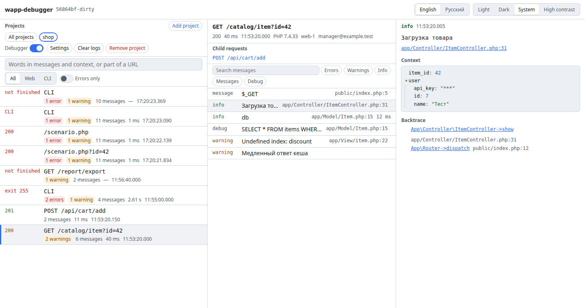

# wapp_php_debugger

[](https://github.com/hightemp/wapp_php_debugger/actions/workflows/ci.yml)
[](https://github.com/hightemp/wapp_php_debugger/actions/workflows/codeql.yml)
[](https://github.com/hightemp/wapp_php_debugger/releases/latest)
[](LICENSE)
[](client-php/README.md)
[](server/go.mod)
[](https://asdertasd.site/counter/wapp_avto_express_debugger)

**English** · [Русский](README.ru.md)

A logger and debugger for PHP projects: a PHP library writes the events of every request into JSONL logs, and a viewer shows requests, messages, backtraces and variables in real time.

> **Status: stable, 1.x.** The viewer is written in Go + Svelte, with a desktop app on Wails; the API and the log format are kept backward compatible since 1.0 (see [ROADMAP.md](ROADMAP.md)). The PHP library 2.x (PHP 7.4+, log format v2) comes with every release as one file and is not on Packagist; the viewer also reads logs of library v1. The plan, phases and decisions are in [IMPROVEMENT_PLAN.md](IMPROVEMENT_PLAN.md) (in Russian); development rules are in [CONTRIBUTING.md](CONTRIBUTING.md).



## Install in one line

```sh
# The viewer (Linux, macOS): picks the build for your system, checks it, puts it into /usr/local/bin or ~/.local/bin
curl -fsSL https://github.com/hightemp/wapp_php_debugger/releases/latest/download/install.sh | sh

# The PHP library as one file, in the root of your project
curl -fsSLO https://github.com/hightemp/wapp_php_debugger/releases/latest/download/wapp-debugger.php
echo '{"enabled": true, "logs_dir": "tmp/logs"}' > dws_debugger.json
```

Then add two lines at the start of the request and run the viewer:

```php
require __DIR__ . '/wapp-debugger.php';
WappDebugger\Debugger::boot(__DIR__ . '/dws_debugger.json');
```

```sh
wapp-debugger serve --logs-dir /var/www/app/tmp/logs   # open http://127.0.0.1:8820
```

The one-liners work from the first published release that carries these files (v0.2.0). Windows: take the zip from [Releases](https://github.com/hightemp/wapp_php_debugger/releases). A specific version: `WAPP_DEBUGGER_VERSION=v0.2.0`, another directory: `WAPP_DEBUGGER_INSTALL_DIR=…` before `sh`.

## Quick start

1. **Or build the viewer from source** (Go 1.26+, Node 22+):

   ```sh
   make ui-deps build                              # dist/wapp-debugger with the embedded UI
   ```

2. **Connect the library 2.x to your project** (PHP 7.4+). Without Composer, copy [`client-php/src`](client-php/src) into the project; then, as early as possible in the request:

   ```php
   require __DIR__ . '/lib/wapp-debugger/autoload.php'; // or Composer's vendor/autoload.php
   WappDebugger\Debugger::boot(__DIR__ . '/dws_debugger.json');
   ```

   and put `dws_debugger.json` into the project root:

   ```json
   {
       "enabled": true,
       "logs_dir": "tmp/logs"
   }
   ```

   The logs directory must be writable by PHP. Log from the code:

   ```php
   __d(DWS_INFO, 'Order created', ['order' => $order]);
   $total = __log($price) * $quantity; // logs a value right inside an expression
   __start('db'); /* ... */ __stop('db'); // timer
   ```

   Errors, exceptions and fatal errors are logged by themselves, secrets are masked. Laravel, Symfony, WordPress and 1C-Bitrix: [client-php/integrations](client-php/integrations/README.md). PSR-3, Monolog, all the settings and the upgrade from library v1 are in [client-php/README.md](client-php/README.md). Old projects can keep library v1 ([`client-php/v1/Debugger.class.php`](client-php/v1/Debugger.class.php)): the viewer reads both.

3. **Run the viewer**:

   ```sh
   dist/wapp-debugger serve                                   # empty: add projects in the UI
   dist/wapp-debugger serve --logs-dir /var/www/app/tmp/logs  # or start with one local project
   # open http://127.0.0.1:8820
   ```

   `--logs-dir` is optional. Without it the viewer starts with no projects: add them in the UI ("Add project") — on this machine, or on an SSH or HTTP server added under "Servers" (see [below](#projects-on-other-servers)). Projects are kept in the database, so later runs need no flags; running with the same `--logs-dir` again adds no duplicate.

   With `--logs-dir`, the project root is found by `dws_debugger.json` above the logs directory (else it is the parent directory); `--root`, `--project` and `--config` set the root, the name and the config path explicitly. New and changed log files are imported in the background and new requests appear on the page as they happen. The debugger switch of a project flips `enabled` in `dws_debugger.json` (`bIsOnFlag` of a v1 config).

   Other flags: `--addr` (default `127.0.0.1:8820`; another address needs a token), `--token` (better `$WAPP_DEBUGGER_TOKEN`, out of the process list), `--db` (the database, by default in the user config directory; `secrets.json` with tokens of HTTP servers lives next to it), `--scan-interval` (fallback rescan of local directories, 5 s). `wapp-debugger serve --help` lists them all.

The UI speaks English and Russian and has light, dark and high-contrast themes (switches in the header; "System" follows the color scheme and the contrast setting of the OS). **Appearance** in the header sets an accent color over any theme, the density of lists, the font size, the font of code (one installed on your computer) and a frame around the window in the color of stage and prod. The **theme editor** there makes themes of your own: colors over a built-in theme with a live preview and a contrast check, shared as `.theme.json` files (Export, Import). The viewer keeps these settings, so every browser and the desktop app look the same. Search looks for words in messages and their context or for a part of the URL.

## Projects on other servers

Servers are added under **Servers** in the projects panel; a project then goes to its server ("Add project", the server choice). **Check** on a server shows each step: the connection, the logs directory of each project (readable, writable), the library config and the PHP version.

### SSH

The main way: nothing to open on the server, no extra software there.

- The host is a name or an alias from `~/.ssh/config`: `HostName`, `User`, `Port`, `IdentityFile`, `IdentitiesOnly` and `ProxyJump` chains are honoured. Keys come from `IdentityFile` first, then from ssh-agent (`SSH_AUTH_SOCK`). Passwords and keys with a passphrase not loaded into the agent are not supported yet.
- Host keys are checked against `~/.ssh/known_hosts`. A new host shows its fingerprint and key type with the command to compare it on the server (`ssh-keygen -lf /etc/ssh/ssh_host_ed25519_key.pub`); the confirmed key goes to the viewer's own file, `~/.ssh/known_hosts` is never written. A changed key is refused.
- Logs are read over SFTP and polled every 2 seconds; one connection per server with keepalive and reconnection. The debugger switch rewrites `dws_debugger.json` on the server at once (a temporary file, then rename) and keeps its permissions. A **read-only** server allows neither.
- Logs of PHP inside Docker on that server: point the project to the volume directory on the host.
- IDE links of a remote project open the local copy when the project has one ("Local copy for IDE links"), otherwise the file on the server through VS Code (or Cursor) Remote-SSH.

### HTTP mode of the library

For servers without SSH access (shared hosting). Set `http_token` (32+ characters) in the project's `dws_debugger.json` — the library then answers its own API, see [client-php/README.md](client-php/README.md#http-mode) — and add a server of kind **HTTP** with the application address and that token. Use `https://`: over plain `http://` the token and the logs travel unencrypted, and the UI warns about it. The token is kept outside the database in `secrets.json` next to it, readable by the user only, and never shown again. One HTTP server is one application, so it holds one project; the library knows its logs directory.

### Push logs to the viewer

For containers, pods and servers the viewer cannot reach: the logs come to the viewer instead.

1. Start the viewer with a receiver: `wapp-debugger serve --ingest-addr 0.0.0.0:8821`. Only the receiver (`POST /ingest/v2`, [`spec/ingest.yaml`](spec/ingest.yaml)) is on that address; the UI and its API stay on `--addr`, on localhost.
2. In the project settings, **Make a push token**. It is shown once, with the keys for `dws_debugger.json`:
   ```json
   "push_url": "http://viewer.lan:8821/ingest/v2",
   "push_token": "…"
   ```
   With them the library sends its events to the viewer instead of writing files: in batches, every second in a long run, the rest when the request ends. One failed send (2 s timeout) stops logging for that request, so a missing viewer never slows the application down twice. `https://` needs the `openssl` extension, like any HTTPS in PHP.
3. Or leave the library writing files and run the agent next to them: `WAPP_DEBUGGER_PUSH_TOKEN=… wapp-debugger agent --logs-dir /var/www/app/tmp/logs --push http://viewer.lan:8821/ingest/v2`. It sends new lines as they are written and retries what the viewer missed; after a restart it sends the files again and the viewer keeps one copy of every event.

**Errors of pages.** With pushing on, `<?= \WappDebugger\Debugger::instance()->jsTag() ?>` in the page prints the tag of `debugger.js`: uncaught errors with their stack, unhandled rejections and `console.error`/`warn` of the page arrive as a child of the PHP request that printed it. The page carries the token, so use it on dev and stage only. Chrome lets a page reach a receiver in the local network from a page in the same network, or from an HTTPS page.

**Logs of others.** **Import a request** in the project panel takes, besides exports and log files of the library, a PHP error log (`php_errors.log`), a Laravel log (`storage/logs/*.log`) and an nginx error log: the file becomes one request named after it, its entries messages with their levels, files, lines and stacks.

### Many servers at once

- **Finding projects.** **Find projects** on a local or SSH server walks the given directories (4 levels, 5000 directories at most, no symlinks; `vendor`, `node_modules` and `.git` are skipped) for `dws_debugger.json` and lists what it finds with paths resolved the way the library resolves them; one click adds a project.
- **Projects by server.** The projects panel groups projects under their servers with the environment (`dev`, `stage`, `prod` in their own colors) and the live connection state; a server name opens the feed of that server. The combined feed filters by environment and names the project and server of each request.
- **Care on stage and prod.** Clearing logs and removing a project there ask for the project name; the debugger switch asks first.
- **Clocks.** The viewer measures how far each server's clock is off (`date` over SSH, the `Date` header in the HTTP mode) and warns when it is more than 2 seconds: the order of requests across servers would mislead.
- **Retention.** Project settings take how many days and megabytes of requests the viewer keeps in its database; older ones go every 10 minutes, log files are not touched. Imports run at most 4 at a time and give up after 2 minutes, so a slow server does not hold the others back.
- **Export and import.** **Servers → Export / import** gives servers and projects as YAML without secrets (tokens and host keys stay with the viewer), to keep in git or hand to a colleague; importing adds what is missing and changes nothing else. Tokens of imported HTTP servers are set again under **Token**.

## Desktop app

The same viewer in a window, without a network port. Installers are attached to every [release](https://github.com/hightemp/wapp_php_debugger/releases):

| System | File | Notes |
|---|---|---|
| Linux | `.deb`, `.AppImage`, `.tar.gz` | the `.deb` needs `libgtk-4-1` and `libwebkitgtk-6.0-4` (Ubuntu 24.04, Debian 13); the AppImage carries its libraries |
| Windows | `_setup.exe`, `.zip` | installs for the current user, no administrator rights; needs the WebView2 runtime (built into Windows 11) |
| macOS | `.dmg`, `.tar.gz` | one app for Apple silicon and Intel, macOS 11+ |

**First start.** The apps are not signed yet (plan 10.28), so the system asks once:

- macOS: right-click the app → **Open** → **Open**; or `xattr -dr com.apple.quarantine /Applications/wapp-debugger.app`;
- Windows: SmartScreen → **More info** → **Run anyway**;
- Linux: `sudo apt install ./wapp-debugger-desktop_*.deb`, or `chmod +x` the AppImage.

What the desktop adds to the browser version (**Settings** in the header):

- an icon in the tray (the menu bar on macOS) with the number of new requests with errors and a menu of the last ones; closing the window keeps the app there;
- system notifications about new requests with errors — or warnings too — in all or chosen projects; a burst comes as one notice; a click opens the request;
- links `wapp-debugger://open?project=3&request=42&message=1001` open the request in the app (from a chat, a ticket, a script); the installers register the scheme, a second start hands the link to the running window;
- start at login; the window comes back where it was;
- a notice in the header when a newer version is out (GitHub Releases once a day; can be switched off).

From source: `make desktop-build` (needs a C compiler and, on Linux, GTK4 + WebKitGTK 6.0; `make desktop-deps` checks them and prints how to install what is missing on your system), then `dist/wapp-debugger-desktop [--logs-dir …]`; `--logs-dir` is optional here too. `make desktop-package` builds the installers of the current system; more in [desktop/README.md](desktop/README.md).

## Docker

```sh
docker run -d --name wapp-debugger -e WAPP_DEBUGGER_TOKEN=<token> -p 127.0.0.1:8820:8820 \
  --user "$(id -u):$(id -g)" -v /var/www/app:/var/www/app -v wapp-debugger:/data \
  ghcr.io/hightemp/wapp-debugger --logs-dir /var/www/app/tmp/logs
# open http://127.0.0.1:8820/?token=<token>
```

Inside a container the viewer listens on all interfaces, so the token is required. Mount the project at the same path as on the host: paths in the viewer and IDE links then match. `--user` lets the viewer read the logs and switch the debugger in `dws_debugger.json`. `make docker-build` builds the image locally.

## Network access

By default the viewer answers only on `127.0.0.1` and only to loopback host names, which also blocks DNS rebinding. To open it to other machines, set a token; without one the viewer refuses to listen on a non-loopback address:

```sh
WAPP_DEBUGGER_TOKEN=$(openssl rand -hex 32) dist/wapp-debugger serve --addr 0.0.0.0:8820 --logs-dir …
# open http://<host>:8820/?token=<token> once: the token moves to an HttpOnly cookie
# API clients send Authorization: Bearer <token>
```

Prefer the environment variable over `--token`: it does not show up in the process list. The viewer sets a strict Content-Security-Policy, rejects cross-origin writes and limits request bodies to 1 MiB. It does not terminate TLS: across untrusted networks put it behind a TLS proxy or an SSH tunnel.

The library itself has no HTTP commands by default (`?debug_msg=…` needs the `DA_HTTP_TOKEN` constant and the `X-Debugger-Token` header); the new viewer does not use them.

## Layout

| Directory | What |
|---|---|
| `server/` | Viewer in Go: `wapp-debugger serve`, API, live updates, embedded UI |
| `ui/` | Web UI in Svelte, English and Russian |
| `server/cmd/wapp-debugger-desktop/` | Desktop app on Wails v3 |
| `client-php/` | PHP library 2.x; `v1/` keeps library v1 for old projects |
| `spec/` | Log formats, API contracts and fixtures |

Since 1.0, log format v2 and the APIs (`/api/v1`, the receiver of pushed logs, the HTTP mode of the library) change only in a backward compatible way: a library or a script written for 1.0 works with every 1.x viewer ([spec/frozen](spec/frozen/README.md)). Releases have checksums, SBOMs and build provenance (`gh attestation verify <file> --repo hightemp/wapp_php_debugger`); security problems go to a private report ([SECURITY.md](SECURITY.md)).

The old PHP viewer with EasyUI is gone; it stays in the git history (tag `legacy-hotfix` is its last version).

## License

[MIT](LICENSE)
