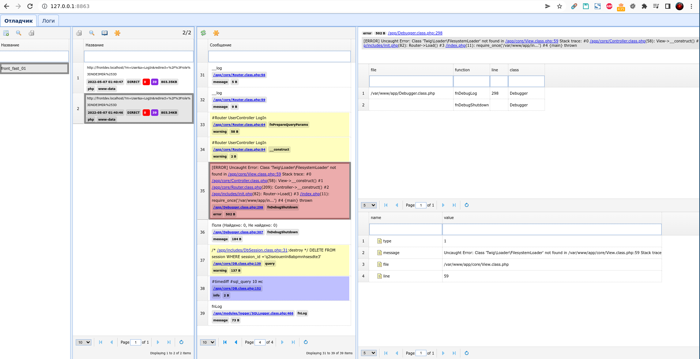

# wapp_php_debugger

[](https://github.com/hightemp/wapp_php_debugger/actions/workflows/ci.yml)
[](https://asdertasd.site/counter/wapp_avto_express_debugger)

[Русская версия](README.ru.md)

A logger and debugger for PHP projects: a PHP library writes the events of every request into JSONL logs, and a viewer shows requests, messages, backtraces and variables in real time.

> **Status: being rewritten.** The viewer is being rewritten in Go + Svelte (with a desktop app on Wails), and the library is becoming a Composer package for PHP 7.4+. The plan, phases and decisions are in [IMPROVEMENT_PLAN.md](IMPROVEMENT_PLAN.md) (in Russian); development rules are in [CONTRIBUTING.md](CONTRIBUTING.md).

## Layout

| Directory | What |
|---|---|
| `server/` | New viewer in Go: `wapp-debugger serve`, API, live updates, embedded UI |
| `ui/` | New web UI in Svelte, English and Russian |
| `server/cmd/wapp-debugger-desktop/` | Desktop app on Wails v3 |
| `client-php/` | New PHP library (in progress) |
| `spec/` | Log formats, API contracts and fixtures |
| `legacy/` | The current library v1 and the old viewer |

## New viewer (preview)

The new viewer already reads logs of the current library v1:

```sh
make build                                        # dist/wapp-debugger with the embedded UI
dist/wapp-debugger serve --logs-dir /var/www/app/tmp/logs
# open http://127.0.0.1:8820
```

It listens on `127.0.0.1` only, imports new and changed log files in the background and pushes new requests to the page as they appear. The desktop app: `make desktop-build`, then `dist/wapp-debugger-desktop --logs-dir …`. The UI language (English or Russian) is switched in the header.

### Network access

By default the viewer answers only on `127.0.0.1` and only to loopback host names, which also blocks DNS rebinding. To open it to other machines, set a token; without one the viewer refuses to listen on a non-loopback address:

```sh
WAPP_DEBUGGER_TOKEN=$(openssl rand -hex 32) dist/wapp-debugger serve --addr 0.0.0.0:8820 --logs-dir …
# open http://<host>:8820/?token=<token> once: the token moves to an HttpOnly cookie
# API clients send Authorization: Bearer <token>
```

Prefer the environment variable over `--token`: it does not show up in the process list. The viewer sets a strict Content-Security-Policy, rejects cross-origin writes and limits request bodies to 1 MiB. It does not terminate TLS: across untrusted networks put it behind a TLS proxy or an SSH tunnel.

## Current version (legacy)

Until the new version is released, `legacy/` is the working version (tag `legacy-hotfix` carries urgent security fixes).

**Library.** Include `legacy/Debugger.class.php` in your project with `require_once` and put `dws_debugger.json` next to it:

```json
{
    "sProjectRootPath": "/var/www/app",
    "sTempPath": "/var/www/app/tmp",
    "sMessagesFilesPath": "/var/www/app/tmp/logs",
    "bIsOnFlag": true
}
```

Logging:

```php
__d(DWS_MESSAGE, 'Order created', ['order' => $order]);
func(__log($a), __log($b)); // capture values right inside an expression
__start('db'); /* ... */ __stop('db'); // timer
```

Values with keys such as `password`, `token` or `api_key` are masked. `$_SESSION` and `$_COOKIE` are logged only with `"bLogSessionAndCookies": true`. HTTP commands (`?debug_msg=…`) work only with the `DA_HTTP_TOKEN` constant and the `X-Debugger-Token` header.

**Old viewer:**

```sh
cd legacy
./bin_start_server.sh        # http://127.0.0.1:8820
# or
cp .env.example .env && docker compose up -d
```


